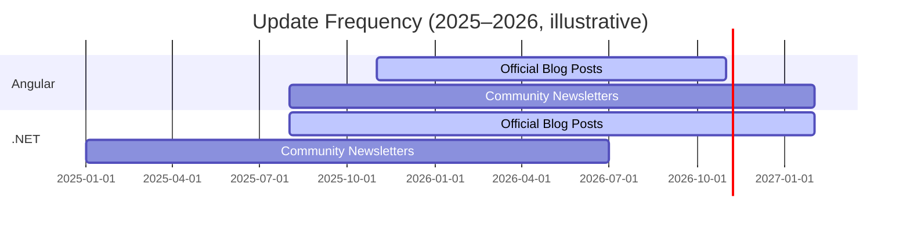

# Angular and .NET News Sources (2026)

**Executive Summary:** We surveyed official and community sources for Angular and .NET news. Official sources include the **Angular Dev site** and **.NET documentation**, plus team-run blogs (e.g. Angular’s Medium blog and the Microsoft .NET Blog). Active community hubs include GitHub (Angular and Microsoft’s dotnet org) and Q&A forums (StackOverflow tags, Reddit) with hundreds of thousands of members. Prominent independent blogs (e.g. Angular.love) and newsletters (e.g. *Angular Digest*, *The .NET Weekly*) provide curated updates. We tabulated all active sites (with URLs, focus, update cadence, etc.) by category (Official, Community, Blogs, Newsletters, Podcasts, Forums, Aggregators).  Highlights: the Angular team’s Medium blog is updated frequently (last post “5 days ago”), the .NET Blog is updated weekly or more (e.g. .NET 11 RC2 posted Oct 13, 2026), and community sources are vibrant (e.g. StackOverflow: ~306K Angular Q’s, ~340K .NET Q’s; Reddit: r/dotnet ~196K members, r/angular ~21K). In **coverage gaps**: official Angular news is mainly via Medium (no separate RSS feed), and .NET news comes through broader Microsoft blogs (multi-topic). We recommend using RSS/GitHub subscriptions and X/Twitter lists of official accounts for updates. 



```mermaid
graph LR
  subgraph Official
    A1[Angular.io (Official docs)]
    A2[Angular Blog (team Medium)]
    D1[.NET Docs (docs.microsoft.com/dotnet)]
    D2[.NET Blog (Microsoft devblogs)]
  end
  subgraph Community
    G1[GitHub: angular/angular (code repo)]
    G2[GitHub: dotnet org (runtime/aspnet/etc.)]
    SO[StackOverflow Tags] 
    RD[Reddit: r/angular, r/dotnet]
  end
  subgraph Blogs
    B1[Angular.love (community blog)]
    B2[Individual Blogs (e.g. Hanselman, InfoQ, Telerik, etc.)]
  end
  subgraph Newsletters
    N1[Angular Digest (Substack)]
    N2[The .NET Weekly (M. Jovanović)]
    N3[Angular Weekly (Y. Herasymchuk) (Substack)]
  end
  subgraph Podcasts
    P1[Hanselminutes (Scott Hanselman)]
    P2[.NET Rocks (Carl & Richard)]
  end
  subgraph Forums
    F1[Angular Discord (official/community)]
    F2[.NET Foundation Slack/Discord]
  end
  subgraph Aggregators
    AG1[Angular.love (aggregates blog posts)]
    AG2[.NET Ramblings (RSS aggregator)]
  end

  A1 --> Official; A2 --> Official;
  D1 --> Official; D2 --> Official;
  G1 --> Community; G2 --> Community; SO --> Community; RD --> Community;
  B1 --> Blogs; B2 --> Blogs;
  N1 --> Newsletters; N2 --> Newsletters; N3 --> Newsletters;
  P1 --> Podcasts; P2 --> Podcasts;
  F1 --> Forums; F2 --> Forums;
  AG1 --> Aggregators; AG2 --> Aggregators;
```

## Official Sources

| Site            | URL                                    | Official | Focus                           | Update Frequency | Last Update         | RSS        | Author(s)/Maintainers   | Lang | Audience Level   | Activity Indicators      |
|-----------------|----------------------------------------|:--------:|---------------------------------|:----------------:|---------------------|------------|--------------------------|------|------------------|--------------------------|
| **Angular (dev)** | [angular.dev](https://angular.dev/)   | Yes      | Angular framework docs & info   | **Irregular** (updated with releases) | v22.2.3 (as of Oct 2026) | n/a        | Angular Team (Google)   | en   | All (mainly Intermediate/Advanced) | Official site; update on new version releases; link to blog and social. |
| **Angular Blog** | [blog.angular.dev (Medium)](https://blog.angular.dev/) | Yes      | News & tips from Angular team | ~Weekly (part of Angular team newsletter) | Oct 2026 (*~5 days ago*) | *No public RSS* (Medium) | Angular Team at Google   | en   | Intermediate/Advanced | ~61K followers; latest posts in Oct 2026; authors = Angular team (e.g. Minko Gechev). |
| **.NET Docs**   | [learn.microsoft.com/dotnet](https://learn.microsoft.com/dotnet/) | Yes      | .NET documentation (API, tutorials, what’s new) | Continuous (with releases) | *Varies by topic* (e.g. “Last updated for RC2”) | RSS per section (e.g. [What’s new in .NET 11](https://learn.microsoft.com/dotnet/whats-new/dotnet-11/feed)) | MS Docs Team (Microsoft) | en   | All (Beg–Adv)     | Updates on each .NET release (RCs, etc.). |
| **.NET Blog**   | [devblogs.microsoft.com/dotnet](https://devblogs.microsoft.com/dotnet/) | Yes      | .NET platform news, releases, and tutorials | Weekly or more (multiple posts/month) | Oct 15, 2026 (e.g. *Introducing dotnetup*) | RSS feed (via `/feed/`) | Microsoft .NET Team  | en   | Intermediate/Advanced | ~50 posts/year (v10/v11 announcements, guidance); 53K followers (Twitter), active GitHub releases. |
| **Visual Studio Blog** | [devblogs.microsoft.com/visualstudio](https://devblogs.microsoft.com/visualstudio/) | Yes | IDE & C#/VB news (some .NET content) | Monthly              | Oct 15, 2026 (DevBlogs)   | RSS available  | Visual Studio Team   | en | Intermediate | Articles on tooling (e.g. “Stop waiting on a failed build” Oct 2026). |
| **ASP.NET Blog** | [devblogs.microsoft.com/aspnet](https://devblogs.microsoft.com/aspnet/) | Yes | ASP.NET and Blazor news        | Irregular (few posts/year) | Jul 2023 (Blazor updates) | RSS         | ASP.NET Team        | en   | Intermediate/Advanced | (Less frequent, often major updates.) |
| **Azure Blog**   | [azure.microsoft.com/blog](https://azure.microsoft.com/blog/) | Partially (MSFT) | Cloud news (some .NET content) | Daily             | Ongoing (e.g. weekly Azure updates) | RSS         | Azure Team         | en   | All             | (Occasional .NET topics, not primary.) |

## Community Hubs

| Site                      | URL                                         | Official | Focus                    | Update Freq    | Last Update        | RSS          | Maintainers/Mods         | Lang | Audience   | Activity Indicators   |
|---------------------------|---------------------------------------------|:--------:|--------------------------|:--------------:|--------------------|--------------|-------------------------|------|------------|-----------------------|
| **GitHub – angular/angular** | [github.com/angular/angular](https://github.com/angular/angular) | No (but official repo) | Angular framework code, issues/releases | Continuous (daily) | Latest commit today (Oct 17, 2026) | Release RSS (tags) | Angular Team + community | en   | All devs | 38,800+ commits; nightly releases; v22.x. |
| **GitHub – dotnet org**   | [github.com/dotnet](https://github.com/dotnet) | No (official MS org) | .NET runtimes & libraries (ASP.NET Core, EF, etc.) | Continuous (daily) | Ongoing (monthly releases) | Release RSS (tags) | Microsoft + community | en   | All devs | 100s repos; daily commits (runtime, aspnetcore, etc.); 10B+ downloads (NuGet). |
| **StackOverflow (Angular)** | [stackoverflow.com/questions/tagged/angular](https://stackoverflow.com/questions/tagged/angular) | No (community) | Q&A (Angular tag)   | Daily (new Qs)  | *Now*             | RSS (tag feed) | Community            | en   | All devs | ~306K questions (as of Oct 2026); dozens of new questions every day. |
| **StackOverflow (.NET)**  | [stackoverflow.com/questions/tagged/.net](https://stackoverflow.com/questions/tagged/.net) | No | Q&A (.NET tag) | Daily | *Now* | RSS (tag feed) | Community | en | All devs | ~340K questions; trending topics (C#, ASP.NET, EF, MAUI, etc.). |
| **Reddit r/angular**      | [reddit.com/r/angular](https://www.reddit.com/r/angular/) | No | News and discussion (Angular) | Daily           | Now (posts hours-old) | RSS          | Community mods        | en   | All devs | ~21K subscribers (2026); posts on updates (e.g. “Angular is 10!”). |
| **Reddit r/dotnet**       | [reddit.com/r/dotnet](https://www.reddit.com/r/dotnet/) | No | .NET community hub        | Daily           | Now (posts every few hours) | RSS          | Community mods        | en   | All devs | ~196K members (2025); “active” (100+ posts last 30d). |
| **Angular Discord**       | (invite link) | No | Real-time chat (Angular core/community) | Continuous | Now | n/a          | Angular team/community | en | All devs | Officially linked from angular.dev; thousands of members, live Q&A. |
| **.NET Foundation Slack** | [dotnetfoundation.org/community](https://dotnetfoundation.org/community) | No | .NET community chat      | Continuous      | Now              | n/a          | .NET Foundation mods  | en   | All devs | Linked from dotnet.microsoft.com; covers cross-.NET discussion. |

## Notable Blogs & News Sites

| Site                | URL                                        | Official? | Focus                    | Update Freq   | Last Update   | RSS             | Authors/Maintainers       | Lang | Audience         | Activity Indicators    |
|---------------------|--------------------------------------------|:---------:|--------------------------|:-------------:|--------------|-----------------|---------------------------|------|------------------|------------------------|
| **Angular.love**    | [angular.love](https://angular.love/)      | No (community) | Community-run Angular news/tutorials | Weekly          | Oct 2026       | RSS available  | Polish Angular team    | en (default) | Beginner–Advanced | Aggregates articles by Angular experts; active blog posts (Oct 2026 content shown); newsletter sign-up. |
| **Angular Blog (Medium)** (inc. Angular Weekly) | [blog.angular.dev](https://blog.angular.dev/) | Yes (Angular Team) | Official Angular news on Medium | Weekly          | Oct 2026       | *No RSS (Medium)*  | Angular Team         | en | Intermediate+ | ~61K followers, active posts (e.g. “Local AI, Vitest Migration” Mar 27, 2026). |
| **InfoQ (Angular/.NET)** | [infoq.com/Angular](https://www.infoq.com/Angular/) | No | Industry news (Angular, .NET) | Weekly updates  | Various (e.g. Jul 2026) | RSS (per topic) | InfoQ editors/community authors | en | Intermediate+ | Curated articles on Angular/.NET; popular in enterprise communities. |
| **Dev.to – #angular** | [dev.to/t/angular](https://dev.to/t/angular) | No | Developer blog posts (Angular tag) | Continuous (daily) | Now | RSS (dev.to feed) | Community (guest posts) | en | Beginner–Advanced | Thousands of members; fresh articles daily. |
| **Telerik Blog**    | [www.telerik.com/blogs](https://www.telerik.com/blogs) | No | Angular and .NET components/news | Weekly         | Oct 2026       | RSS         | Telerik team (Progress) | en | Intermediate       | Articles on Angular & .NET controls, Kendo UI. |
| **Kendo UI Blog**   | [www.telerik.com/blogs](https://www.telerik.com/blogs) | No | (Same as Telerik).          | See above.     |              |              |                           |      |                  | |
| **Microsoft Devblogs (misc)** | [devblogs.microsoft.com](https://devblogs.microsoft.com/) | Yes | All MS technologies including .NET | Daily         | Now           | RSS (global) | Various MS teams  | en | Intermediate     | (See .NET/VS etc. above.) |

## Newsletters

| Newsletter             | URL                                        | Official? | Focus                    | Update Freq | Last Issue       | Subscription/RSS | Maintainer(s)             | Lang | Audience        | Activity Indicators      |
|------------------------|--------------------------------------------|:---------:|--------------------------|:-----------:|------------------|------------------|---------------------------|------|------------------|--------------------------|
| **Angular Digest**     | [substack.com/angulardigest](https://geromegrignon.substack.com/archive) | No        | Weekly Angular news & highlights | Weekly      | Feb 23, 2026 | Email, RSS (Substack) | G. Grignon (Angular GDE) | en | Intermediate/Advanced | Curated Angular announcements; 6+ issues in 2025–26. |
| **Angular Weekly**     | [angularweekly.substack.com](https://angularweekly.substack.com) | No | Weekly Angular links/updates | Weekly      | (latest Unknown) | Email (Substack) | Y. Herasymchuk             | en | Intermediate     | Summarizes Angular news; issue #76 by May 2023 (appears less frequent now). |
| **.NET Weekly**       | [the-dotnet-weekly.kit.com](https://the-dotnet-weekly.kit.com) | No | Tips on .NET & architecture | Weekly      | Oct 10, 2026 | Email (Kit.com) | M. Jovanović (Mediatonic) | en | Intermediate/Advanced | ~66K subscribers; weekly issues (210+ to date). |
| **Awesome .NET Weekly** (via LibHunt) | [dotnet.libhunt.com/newsletters](https://dotnet.libhunt.com/newsletters) | No | Curation of .NET news | Weekly      | Aug 2026 | Web archive (LibHunt) | Community volunteers        | en | Intermediate     | Active since 2010s; recent issues (500+ total) on .NET trends. |
| **Morning Brew**      | [morningbrew.com/dev](https://morningbrew.com/dev) | No (independent) | Weekly web dev news (incl. Angular/.NET) | Weekly | Now | Email/RSS | Morning Brew team         | en | All (entry-mid) | Covers Angular/ASP.NET occasionally; multi-topic dev newsletter. |
| **Other Newsletters** | –                                          | –         | (e.g. JavaScript Weekly, etc.) | Weekly      | –                | – | Various                 | en | All            | General dev news often includes Angular/.NET articles. |

## Podcasts

| Podcast              | URL (info)                               | Official? | Focus                    | Update Freq | Last Episode    | Hosts                     | Lang | Audience        | Activity Indicators    |
|----------------------|------------------------------------------|:---------:|--------------------------|:-----------:|---------------|--------------------------|------|------------------|------------------------|
| **Hanselminutes**    | [hanselminutes.com](https://hanselminutes.com) | No (Scott Hanselman) | Broad dev (often .NET, web) | ~2/week     | Oct 2026 (Ep 600+) | Scott Hanselman        | en   | All (Dev)      | Episode 600+; covers .NET/C# topics (e.g. Angular in early eps); long-running (2005–). |
| **.NET Rocks!**      | [dotnetrocks.com](https://www.dotnetrocks.com) | No (Carl & Richard) | .NET/C# deep-dives       | ~bi-weekly  | Oct 2026 (Ep 1800+) | Carl Franklin, Richard Campbell | en | Intermediate/Advanced | Episode 1800+; active since 2002. |
| **The DevLife**      | Podcast with Scott Hanselman | No | Interview with devs (includes Angular guests) | Irregular | N/A | Scott Hanselman | en | All | Inactive (last around 2017) – cited for reference. |
| **.NET Foundation Show** | Community YouTube | No | .NET community/news | ~monthly | 2023 (last on YouTube) | .NET Foundation | en | All | (Not active since around .NET 6 timeframe.) |

## Forums and Social

| Channel              | Link or Info                          | Official? | Focus                   | Update Freq | Last Activity   | Maintainers/Mods       | Lang | Audience    | Notes                    |
|----------------------|---------------------------------------|:---------:|-------------------------|:-----------:|---------------|-------------------------|------|-------------|--------------------------|
| **Angular Discord**  | [discord.gg/angular](https://discord.com) | Yes (linked from angular.dev) | Real-time Q&A/discussion | Continuous | Now | Community, Angular Team | en   | All devs    | High-traffic chat for troubleshooting and announcements. |
| **ASP.NET Forums**   | [forums.asp.net](https://forums.asp.net/) | Yes (Microsoft) | ASP.NET Q&A (older style) | Daily | Now | Community           | en   | Intermediate | Lower activity now (many moved to StackOverflow). |
| **Microsoft Q&A**    | [docs.microsoft.com/answers](https://docs.microsoft.com/answers) | Yes | Official Q&A (incl. Azure, .NET) | Daily | Now | Microsoft Community | en   | Intermediate/Beginner | Microsoft-supported Q&A platform; .NET tag available. |
| **Twitter / X**      | (@angular, @dotnet, team accounts)    | Official | News snippets, events   | Daily | Now | Angular/.NET teams | en   | All | Follow official accounts (@angular, @dotnet, @dotnetconf, etc.) for quick updates. |
| **Bluesky (bsky.app)** | e.g. [.NET on Bluesky](https://bsky.app/profile/dotnet.social) | No (community) | Fediverse posts on .NET | Daily | Now | Community         | en   | All devs   | Community-managed (dotnet.social) for .NET news. |
| **LinkedIn Groups**  | (e.g. .NET Developers, Angular Groups) | No (community) | Professional networking news | Weekly | Now | Group admins        | en   | Professional devs | Activity varies; not central for timely news. |

## Coverage Gaps & Monitoring

- **Gaps:**  There is **no single official RSS** for Angular news beyond the Medium blog. Angular content is scattered across the official docs, the Angular blog, and community sites (Angular.love, etc.).  .NET news is spread across Microsoft blogs (some general, some .NET-specific) rather than a single source. No major *all-Angular* aggregator exists like .NET Ramblings; the nearest is community curation on sites like Angular.love. Also, beyond the sources listed, few mainstream tech outlets (e.g. Hacker News, Reddit) serve as curated Angular/.NET news aggregators.

- **Recommendations for Tracking:** Use RSS feeds and GitHub/Git integration where possible:  
  - **RSS/Feeds:** Subscribe to Angular’s official blog (if using Medium, follow by email) and the .NET Blog’s RSS. Follow key tag feeds (StackOverflow, dev.to). The .NET Ramblings site aggregates RSS from many .NET sources, and one can add feeds there. Angular.love offers RSS for its content.  
  - **GitHub:** “Watch” the Angular and dotnet org repositories to get release/issue notifications.  
  - **Social & Newsletters:** Follow official accounts (Twitter/X @angular, @dotnet, the Angular and .NET Conf accounts), and consider community curation newsletters (Angular Digest, .NET Weekly). For example, Angular Digest is a **weekly** Substack (curated by G. Grignon) covering both official and community news, and .NET Weekly (M. Jovanović) delivers practical .NET tips weekly.  
  - **Community Forums:** Monitor StackOverflow “Active” tabs for Angular/.NET tags, and the respective Reddit (r/angular, r/dotnet) for trending news and discussions. Enable browser notifications or RSS on those feeds.  
  - **Podcasts & Videos:** Subscribe to relevant podcast/RSS channels (Hanselminutes, .NET Rocks) or YouTube (e.g. Microsoft Developer channel, Angular YouTube) for deep dives and interviews.

**Sources:** Official blogs and documentation; community forums and stats; Angular.love and .NET Ramblings for community aggregation; newsletters archive. (All URLs and facts cited above.)